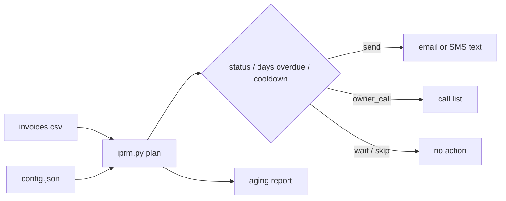

# Invoice Payment Reminder Automation: free open-source Python tool to chase overdue invoices

   

**Invoice Payment Reminder Automation is a free, self-hosted Python tool that turns an invoice CSV into a daily plan of who to remind, how, and with what message, using escalating friendly, firm and final tiers, cooldowns and an aging report. It is built for freelancers, agencies and small service businesses (roofing, HVAC, clinics, salons, real estate).**

It only plans and renders messages. It never sends anything, so you can plug the output into your own email, SMS, WhatsApp, n8n or Zapier flow.

## Why / problem it solves

Late payments quietly eat cash flow. Most "automatic payment reminder" tools are paid SaaS, and accounting add-ons are heavy. Owners end up chasing invoices from memory. This tool is a lightweight, free alternative to paid dunning/reminder apps (like Paynudge-style SaaS) when all you need is *who to chase today and what to say*.

## 2-minute Quickstart

```bash
git clone https://github.com/Waqas-Ai-Engineer/invoice-payment-reminder-automation
cd invoice-payment-reminder-automation
python iprm.py demo --messages          # offline demo on sample data
python iprm.py plan example_invoices.csv --config example_config.json --today 2026-10-16
python iprm.py plan my_invoices.csv --format json   # feed n8n / Zapier / scripts
python iprm.py aging my_invoices.csv
python -m unittest                      # run tests
```

No dependencies. Python 3.8+.

## Demo output (sample data, produced by running the demo)

```text
Payment reminder plan for 2026-10-16

INVOICE  CUSTOMER                    AMOUNT  DAYS  ACTION           TIER        REASON
--------------------------------------------------------------------------------------
INV-1004 Sample Realty Group       8,900.00    46  owner_call/phone call_owner  high value: needs a personal call
INV-1006 Demo Law Office           2,100.00    63  owner_call/phone call_owner  over 45 days overdue: needs a personal call
INV-1002 Demo Roofing Co           3,400.50    27  send/sms         final       27 days overdue -> final reminder
INV-1010 Sample Auto Repair        1,850.00     4  send/email       friendly    4 days overdue -> friendly reminder
INV-1001 Sample Dental Clinic      1,200.00    16  send/email       firm        16 days overdue -> firm reminder
INV-1007 Example Bakery              300.00    11  owner_call/phone firm        no email or phone on file
INV-1003 Example Salon               450.00     0  send/email       pre_due     due soon heads-up
INV-1005 Test HVAC Services          760.00     6  wait/none        friendly    reminded 2d ago (cooldown 5d)
INV-1008 Sample Gym                   95.00    16  skip/none                    status is paid
INV-1009 Demo Studio                 640.00    15  skip/none                    status is disputed

AGING REPORT (outstanding, excludes paid/void/disputed)
BUCKET     COUNT         TOTAL
not due        1        450.00
1-7            2      2,610.00
8-21           2      1,500.00
22-45          1      3,400.50
46+            2     11,000.00
OVERDUE              18,510.50

4 reminders to send, 3 needs a personal call, 18,200.50 chased today.
```

## Features

- Escalating tiers: pre-due heads-up, friendly, firm, final, then "call the owner".
- Cooldown between reminders so customers are not spammed.
- Skips paid, void and disputed invoices.
- High-value invoices and invoices past the reminder cap go to a personal call list.
- Aging report (not due, 1-7, 8-21, 22-45, 46+ days).
- Rendered email/SMS text per invoice; output as table, JSON or CSV.
- Fully configurable via a small JSON file (tiers, cooldown, threshold, pay link).
- Pure standard library, typed, tested.

## How it works



## CSV format

Required columns: `invoice_id, customer, amount, due_date` (YYYY-MM-DD). Optional: `email, phone, currency, issue_date, status, last_reminder, reminders_sent`. See `example_invoices.csv`.

## Use cases by industry

- **Roofing and HVAC contractors:** chase job invoices after completion without awkward manual calls.
- **Clinics and dental practices:** remind self-pay balances politely.
- **Salons and gyms:** nudge recurring or one-off unpaid invoices.
- **Real estate and property managers:** escalate large balances to a personal call.
- **Freelancers and agencies:** a daily "who owes me money" list.

## FAQ

**How do I automatically send overdue invoice reminders for free?**
Export unpaid invoices to CSV, run `python iprm.py plan invoices.csv --format json` daily, and send the `send` rows with your own email/SMS tool or an n8n flow.

**Does this tool send emails or texts itself?**
No. It plans and renders messages only, so you stay in control and no credentials are needed.

**Is Invoice Payment Reminder Automation free?**
Yes, MIT licensed, no paid tier.

**How is it different from paid reminder apps?**
It is local, scriptable and transparent, but has no payment page, no inbox and no accounting sync. Use it when you want a simple self-hosted planner.

**How often should I remind a customer about an overdue invoice?**
The default cooldown is 5 days and the cap is 4 reminders; change both in the config.

**Can I change the message wording?**
Yes, edit `render_message` in `iprm_core.py`. Templates as config are on the roadmap.

**Is it legal to send payment reminders?**
Rules on debt collection vary by country. See COMPLIANCE.md. This is not legal advice.

## Roadmap

- Message templates in JSON, multi-language
- Late-fee calculation
- Optional CSV export for mail-merge
- n8n importable workflow example

## Contributing

Issues and pull requests are welcome. See CONTRIBUTING.md.

## Hire me / Need this built?

Muhammad Waqas, AI Agents & Business Automation. Custom invoice follow-up, WhatsApp/email automation and n8n workflows: reach out via https://github.com/Waqas-Ai-Engineer

## License

MIT, see LICENSE.

---

Star this repo if it helped. Follow [@Waqas-Ai-Engineer](https://github.com/Waqas-Ai-Engineer) for daily open-source automation tools.
